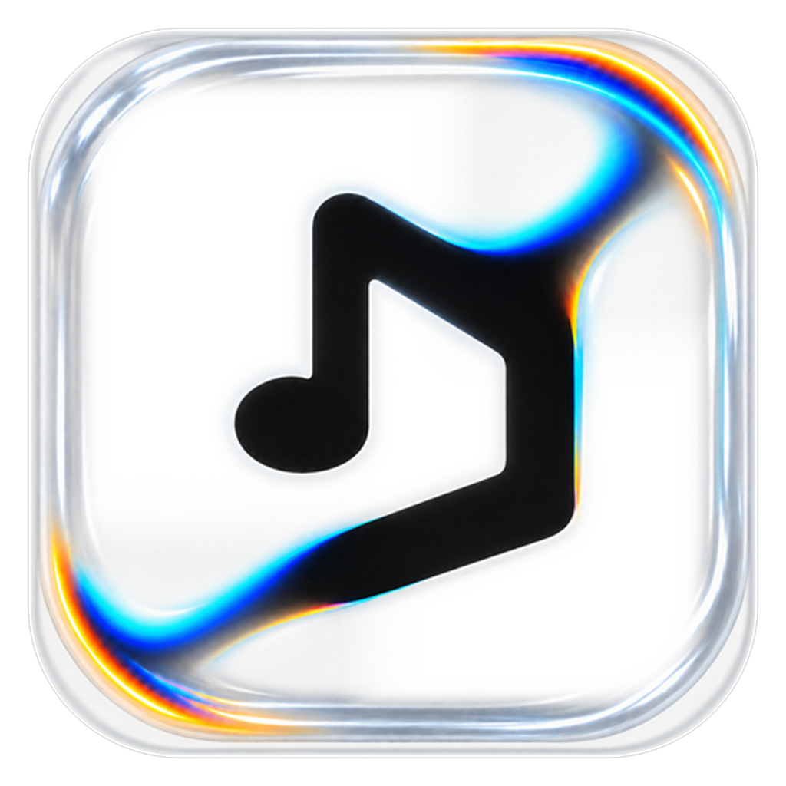
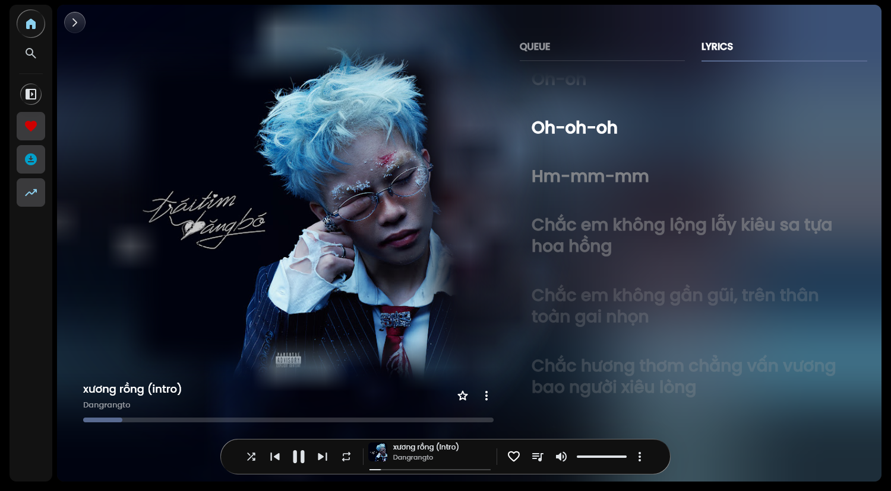
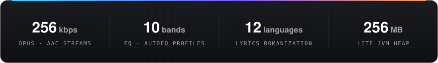
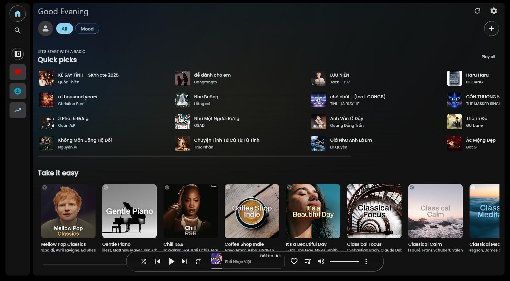
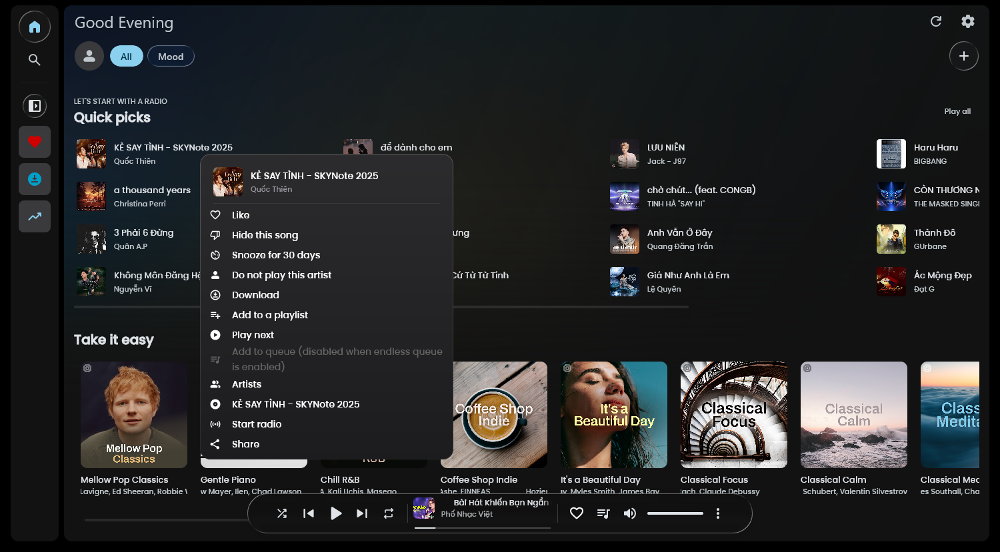
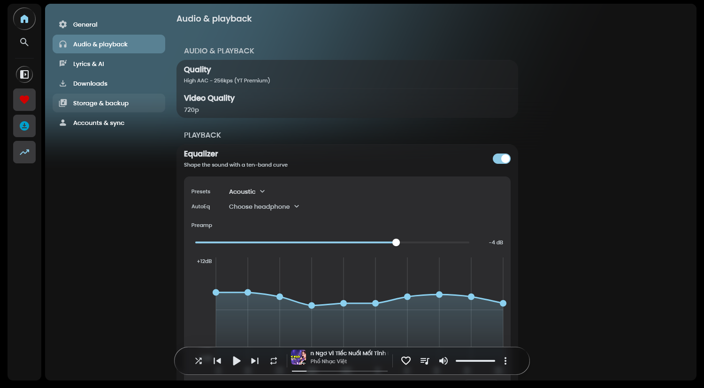
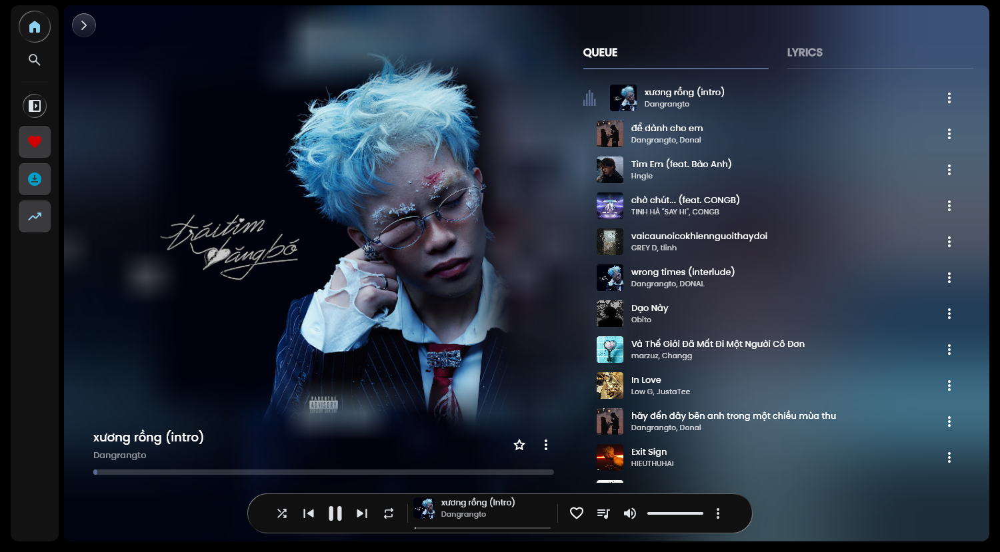
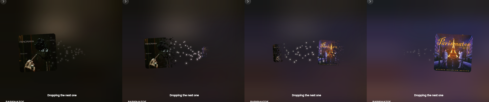
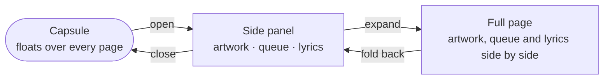

<div align="center">



<h1>Barotify</h1>

**YouTube Music player for Windows and Android, with a liquid-glass interface.**<br>
Ad-free · background playback · open source

<br>

<a href="../../releases/latest"></a>&nbsp;
<a href="../../releases/latest"></a>&nbsp;
<a href="../../releases/latest"></a>

<sub>Not sure which Windows build to pick? Read <a href="#barotify-or-barotify-lite">Barotify or Barotify Lite</a> below.<br>
Hướng dẫn tiếng Việt nằm trong các mục <b>Tiếng Việt</b> có thể bấm mở.</sub>

<br><br>

<a href="../../releases"></a>


<br><br>



</div>

<br>

<div align="center">

</div>

## Highlights

<table>
<tr>
<td valign="top" width="33%">
<samp>01 / INTERFACE</samp><br>
<b>Liquid glass</b><br>
Sidebar, player capsule, menus and dialogs share one glass material.
</td>
<td valign="top" width="33%">
<samp>02 / DESKTOP</samp><br>
<b>Built for a pointer</b><br>
Right-click menus, hover states and compact rows. No ripples, bottom sheets or toasts.
</td>
<td valign="top" width="33%">
<samp>03 / INPUT</samp><br>
<b>Keyboard shortcuts</b><br>
<kbd>Space</kbd> <kbd>Esc</kbd> <kbd>Alt</kbd>+<kbd>←</kbd> <kbd>F11</kbd> and the mouse back button.
</td>
</tr>
<tr>
<td valign="top">
<samp>04 / PLAYBACK</samp><br>
<b>Crossfade with motion</b><br>
The outgoing cover dissolves into the next one, timed to the audio fade.
</td>
<td valign="top">
<samp>05 / LYRICS</samp><br>
<b>Synced, word by word</b><br>
Several sources with fallback, romanization for 12 languages, AI translation.
</td>
<td valign="top">
<samp>06 / PRIVACY</samp><br>
<b>Local by default</b><br>
Analytics and recommendations are opt-in and stay on the device.
</td>
</tr>
</table>

<div align="center">
<table>
<tr>
<td align="center" width="50%"><br><b>Home</b><br><sub>YouTube Music shelves, speed dial, local picks</sub></td>
<td align="center" width="50%"><br><b>Right-click menus</b><br><sub>Glass popover anchored at the cursor</sub></td>
</tr>
<tr>
<td align="center"><br><b>Settings</b><br><sub>Two-column source list</sub></td>
<td align="center"><br><b>Full-page player</b><br><sub>Artwork beside the queue or synced lyrics</sub></td>
</tr>
</table>

<br>
<sub><b>Crossfade hand-over</b> · cover dissolve and background colour transition, synced to the audio fade</sub>
</div>

<br>

## Barotify or Barotify Lite?

Same app, same features. Lite turns off GPU-heavy effects and runs the JVM with a smaller heap and a single-threaded GC.

| | **Barotify** | **Barotify Lite** |
| :--- | :--- | :--- |
| Best for | Most PCs | Older PCs, 4–8 GB RAM, laptops on battery |
| Liquid glass and blur | On | Off, solid surfaces |
| Animated player background | Mesh blur | Off |
| Crossfade cover hand-over | Particle dissolve | Off, audio crossfade still works |
| Moving album artwork | On | Off, still cover |
| Shimmer, playing bars, sweep effects | Animated | Still |
| Synced-lyrics wipe | Display refresh rate | 24 fps |
| Cover image size in memory | Full size | Up to 640 px, 24 MB cache |
| Java heap | Up to 512 MB | Starts at 32 MB, up to 256 MB |
| Window title | Barotify | Barotify Lite |
| Platforms | Windows · Android | Windows only |

Both can be installed side by side: Lite has its own installer ID and install folder.

**Measured** on the packaged 2.5.0 builds, Windows 11, 1500×860 window:

| | **Barotify** | **Barotify Lite** |
| :--- | :--- | :--- |
| Memory, idle on Home | ~540 MB | ~400 MB |
| CPU, idle on Home | 2–6 % of one core | 1–3 % |
| CPU, playing on Home | — | ~8 % |

Neither build redraws a window when nothing on it moves: titles that do not fit scroll only after the pointer rests on them for 3 seconds, and the playback position reaches the UI 4 times a second unless synced lyrics are on screen.

<details>
<summary><b>Tiếng Việt: nên chọn bản nào?</b></summary>
<br>

Hai bản **giống hệt nhau về tính năng**. Bản Lite chỉ tắt các hiệu ứng nặng (kính mờ, nền động, hiệu ứng bìa tan thành bụi khi chuyển bài, ảnh bìa động, các hiệu ứng lặp trang trí) và giới hạn bộ nhớ Java xuống 256 MB. Đo trên máy thật: bản thường khoảng 540 MB khi để yên, bản Lite khoảng 400 MB.

- Máy bình thường: tải **Barotify**.
- Máy yếu, RAM 4–8 GB, laptop chạy pin: tải **Barotify Lite**.
- Cài được cả hai cùng lúc, bản Lite không ghi đè bản thường.

</details>

<br>

## Install

> [!IMPORTANT]
> Barotify is a preview build and the Windows installer is **not code-signed** yet. Windows SmartScreen may warn you the first time. That is expected for unsigned apps.

### Windows

1. Open the [latest release](../../releases/latest) and download one file:
   - `Barotify-<version>-windows-x64-setup.exe` for the full app, or
   - `Barotify-Lite-<version>-windows-x64-setup.exe` for Lite.
   - Prefer no installer? Take the matching `-portable.zip`, unzip it anywhere and run `Barotify.exe` (or `Barotify Lite.exe`).
2. Run the setup. It installs for your user only, so it needs **no administrator rights**.
3. If SmartScreen appears, click **More info → Run anyway**.

Requires Windows 10 (1809) or newer, 64-bit. Java is bundled, nothing else to install.

<details>
<summary><b>Tiếng Việt: cài trên Windows</b></summary>
<br>

1. Mở [bản phát hành mới nhất](../../releases/latest), tải **một** file:
   - `Barotify-<phiên bản>-windows-x64-setup.exe` cho bản đầy đủ, hoặc
   - `Barotify-Lite-<phiên bản>-windows-x64-setup.exe` cho bản Lite.
   - Không muốn cài? Tải file `-portable.zip` tương ứng, giải nén rồi chạy `Barotify.exe` (hoặc `Barotify Lite.exe`).
2. Chạy file cài. Chỉ cài cho tài khoản của bạn, **không cần quyền admin**.
3. Nếu Windows SmartScreen hiện cảnh báo, bấm **Thông tin thêm → Vẫn chạy**.

Cần Windows 10 (bản 1809) trở lên, 64-bit. Đã kèm sẵn Java, không phải cài thêm gì.

</details>

### Android

1. Download the `.apk` from the [latest release](../../releases/latest) on your phone.
2. Open it. If Android asks, allow your browser or file manager to **install unknown apps**.
3. Open Barotify and sign in to YouTube Music if you want your library and playlists.

Requires Android 8.0 or newer.

<details>
<summary><b>Tiếng Việt: cài trên Android</b></summary>
<br>

1. Tải file `.apk` từ [bản phát hành mới nhất](../../releases/latest) bằng điện thoại.
2. Mở file. Nếu máy hỏi, cho phép trình duyệt hoặc trình quản lý file **cài ứng dụng không rõ nguồn gốc**.
3. Mở Barotify, đăng nhập YouTube Music nếu muốn dùng thư viện và playlist của bạn.

Cần Android 8.0 trở lên. Muốn chuyển đăng nhập sang máy tính: quét mã QR trong phần Tài khoản của bản Desktop.

</details>

<br>

## Quick tour

### One player, three sizes

The desktop player has three states: a floating capsule, a side panel and a full page.



A separate always-on-top **mini player window** shows the cover, title and transport controls; the remaining controls appear on hover.

### Keyboard and mouse

| Shortcut | What it does |
| :--- | :--- |
| `Space` | Play / pause |
| `Esc` | Close the newest menu or dialog, then the player, then go back |
| `Alt+←` or mouse back button | Go back |
| `F11` | Full screen |
| Right-click a song, album or playlist | Open its menu where you clicked |

<details>
<summary><b>Tiếng Việt: dùng nhanh</b></summary>
<br>

- **Trình phát có 3 cỡ:** viên thuốc nổi khi duyệt nhạc → bảng bên phải → cả trang, và thu lại theo chiều ngược.
- **Tên bài dài:** đứng yên, rê chuột lên 3 giây thì chạy chữ.
- **Mini player:** cửa sổ nhỏ luôn nổi trên các ứng dụng khác, rê chuột vào mới hiện thêm nút.
- **Phím tắt:** `Space` phát/dừng, `Esc` đóng menu rồi đóng trình phát rồi quay lại, `Alt+←` hoặc nút back trên chuột để quay lại, `F11` toàn màn hình.
- **Chuột phải** vào bài hát, album, playlist để mở menu ngay chỗ bấm.

</details>

<br>

## Features

<table>
<tr>
<td valign="top" width="50%">

<samp>LISTENING</samp>

- YouTube Music and YouTube, free, ad-free, in the background
- Up to 256 kbps (Opus or AAC) for Premium accounts
- Crossfade, including DJ-style auto crossfade
- Ten-band equalizer, presets, AutoEq headphone profiles, Delay and Reverb
- Choose the speaker or headphones to play on
- Sleep timer with a gentle fade-out
- SponsorBlock and Return YouTube Dislike

<samp>LYRICS</samp>

- Synced lyrics from LRCLIB, YouTube Music, KuGou and more, with fallback when a source has the wrong song
- Word-by-word lyrics with a timing offset
- Romanization for 12 languages and AI translation
- Add your own synced lyrics, share lyrics as an image

</td>
<td valign="top" width="50%">

<samp>LIBRARY · DISCOVERY</samp>

- Home, charts, moods, genres and podcasts
- Playlists synced with YouTube Music, local playlists, playlist import
- Accent-insensitive filters and search history (`mat nham` finds *Mắt Nhắm*)
- On-device analytics, a yearly Wrapped and monthly recap playlists
- Smart local recommendations, opt-in

<samp>DESKTOP</samp>

- Capsule, side panel and full-page player
- Always-on-top mini player window
- Windows media controls, Discord Rich Presence
- Last.fm scrobbling (in builds made with Last.fm API keys)

<samp>ANDROID</samp>

- Media session controls, Android Auto, home screen widgets
- Send your sign-ins to the desktop app with a QR code

</td>
</tr>
</table>

<br>

## Under the hood

<div align="center">


</div>

| Layer | Implementation |
| :--- | :--- |
| UI | Compose Multiplatform, shared between Windows and Android |
| Audio, Windows | libmpv over JNA, dual-handle crossfade |
| Audio, Android | Media3 ExoPlayer with custom audio processors (EQ, crossfade, sleep fade) |
| Storage | Room (SQLite), DataStore |
| Design tokens | `GlassDefaults`: every colour, radius, blur and duration in one object |

**Lite** is the same app image with a second launcher, `Barotify Lite.exe`. Its launcher config sets `-Dbarotify.lite=true`, which disables the effects listed above, and adds these JVM options:

| JVM option | Why |
| :--- | :--- |
| `-Xms32m` | Start small. The default initial heap (1/64 of RAM) committed 256 MB at launch, and the serial GC never returned it |
| `-Xmx256m` | Half the full build's heap ceiling |
| `-XX:+UseSerialGC` | No parallel GC threads; a music player's heap is small |
| `-XX:MinHeapFreeRatio=10` `-XX:MaxHeapFreeRatio=25` | Give freed memory back to Windows |
| `-XX:TieredStopAtLevel=1` | C1 compiler only: far less JIT memory and CPU |
| `-XX:ReservedCodeCacheSize=48m` | Smaller code cache |
| `-XX:+UseStringDeduplication` | Share identical strings |
| `-Xss512k` | Smaller thread stacks |

<br>

## Build from source

Requirements: JDK 21, plus the Android SDK for Android builds.

```bash
./gradlew :desktopApp:run          # run the desktop app
./gradlew :composeApp:jvmTest      # run the tests
./gradlew detekt                   # static analysis
```

The full source of each version is attached to its [release](../../releases) as `Barotify-<version>-source.zip`. In it, `scripts/windows/build-release.ps1` builds both Windows editions in one run (jpackage + Inno Setup): the full and Lite installers, both portable zips, a source zip and `SHA256SUMS`.

<br>

## Privacy

Barotify keeps your listening history on your device. Analytics and smart recommendations are opt-in and stay local. The FOSS build has no crash reporting or tracking.

## Credits and license

Maintained by **BaroPapa**. See [CREDITS.md](CREDITS.md).<br>
Licensed under the [GNU General Public License v3.0](LICENSE).

> [!NOTE]
> Barotify uses YouTube Music's unofficial API and is not affiliated with Google or YouTube. It hosts no media. If you enjoy an artist, support them with YouTube Music Premium.

<br>

<div align="center">
<br>
<sub><b>Barotify</b> · made by BaroPapa</sub>
</div>
